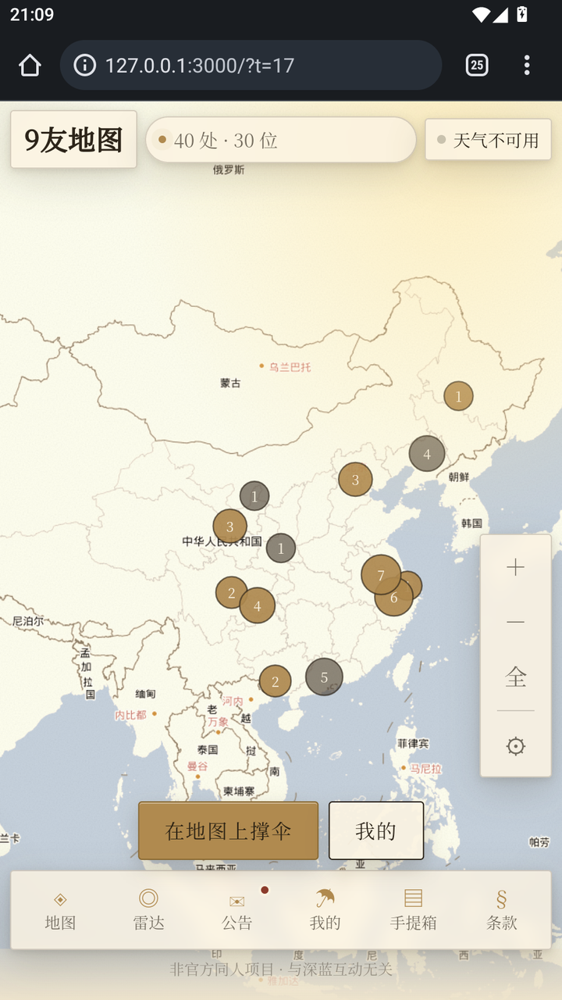
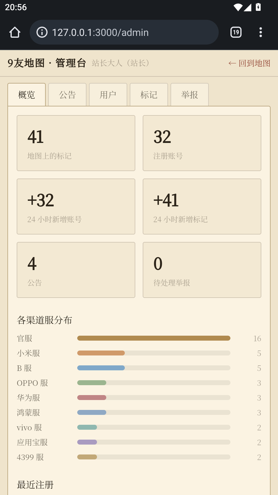

# 9友地图

**《重返未来：1999》玩家的同好地图** —— 在荒原纸面上撑一把伞，找到能真正加上好友的司辰。

> 非官方同人项目，与深蓝互动没有任何关系。



## 一句话说清它解决什么问题

1999 没有公会、没有组队，想找同好只能靠论坛发帖。而**官服和各个渠道服之间不能互加好友**，经常认识了半天才发现加不上。

所以这个站做的事很朴素：**在世界地图上标出你在哪、在哪个服**，让你只和「能加成好友」的人打交道。

- 🌂 **撑伞**：在地图上放下自己的位置（坐标默认模糊到约 500 米）
- 🐰 **金兔子**：可以多放几只，代表"我在别处也留了一只"
- 🏷️ **同服标记**：同服的人铜金描边，异服灰显——一眼看出谁加得上
- 🤝 **递伞**：互相递伞才成为「同伞之交」，对方才看得到你的游戏 UID
- 💬 **轻敲伞沿**：跨服也能敲，纯打招呼，不加好友
- 🌧️ **界面天气**：按你所在城市的真实天气下雨、下雪、起雾
- 📣 **公告 / 举报 / 管理后台**：能运营一个真实社区



## 快速开始

需要 Node.js ≥ 22.5，**不需要 npm install**（零依赖）。

```bash
node server/index.js
# → http://127.0.0.1:3000
```

首次启动会建库并写入 40 个演示点位。想重置：

```bash
node scripts/reset.js
```

把某个账号提成管理员：

```bash
node scripts/admin.mjs promote 你的邮箱
# 然后访问 /admin
```

## 部署

| 方案 | 成本 | 适合 |
|---|---|---|
| **[最省心：Cloudflare 免费](docs/最省心上线.md)** | ¥0 | 不想管服务器（推荐） |
| [自备服务器](docs/部署上线.md) | ¥25–90/月 | 要实时推送、绑大陆域名 |

Cloudflare 那条是全程浏览器点按钮，不用装任何东西。

## 目录

```
server/    Node 运行时（HTTP 路由、SQLite、SMTP、SSE）
worker/    Cloudflare Worker 运行时（D1、WebCrypto、HTTP 邮件）
public/    前端（原生 ES Module + Canvas 自绘地图，零构建）
docs/      方案、法务文本、部署指南
scripts/   构建、备份、测试、管理脚本
```

两套运行时共用 `server/constants.js` 里的业务常量，功能对齐（Worker 版没有实时推送）。

## 技术上的几个选择

- **零依赖**：没有 `node_modules`，只用 Node 内置模块（`node:sqlite`、`node:http`、`node:crypto`）
- **地图自己画**：Canvas 实现瓦片、投影、聚合、命中测试，不引 Leaflet
- **底图用天地图**：坐标系是 CGCS2000，不需要 GCJ-02 纠偏；有审图号
- **位置默认模糊**：服务端做确定性抖动，前端拿不到原始坐标

## 文档

- [舟友地图拆解与 9友地图方案](docs/舟友地图拆解与9友地图方案.md) —— 这个项目的来龙去脉
- [最省心上线](docs/最省心上线.md) · [怎么上传代码](docs/怎么上传代码.md) · [Cloudflare 部署](docs/Cloudflare部署.md) · [服务器部署](docs/部署上线.md)
- [用户协议](docs/legal/01-用户协议.md) · [隐私政策](docs/legal/02-隐私政策.md) · [信息清单](docs/legal/03-个人信息收集与用途清单.md) · [免责声明](docs/legal/04-免责声明.md) · [社区规范](docs/legal/05-社区规范.md)

## 免责

本站是非商业同人项目，与《重返未来：1999》官方无关。游戏内素材权利归深蓝互动所有；如权利人提出异议，会立即删除相关内容。

地图数据来自天地图（国家地理信息公共服务平台），审图号见站点页脚。
